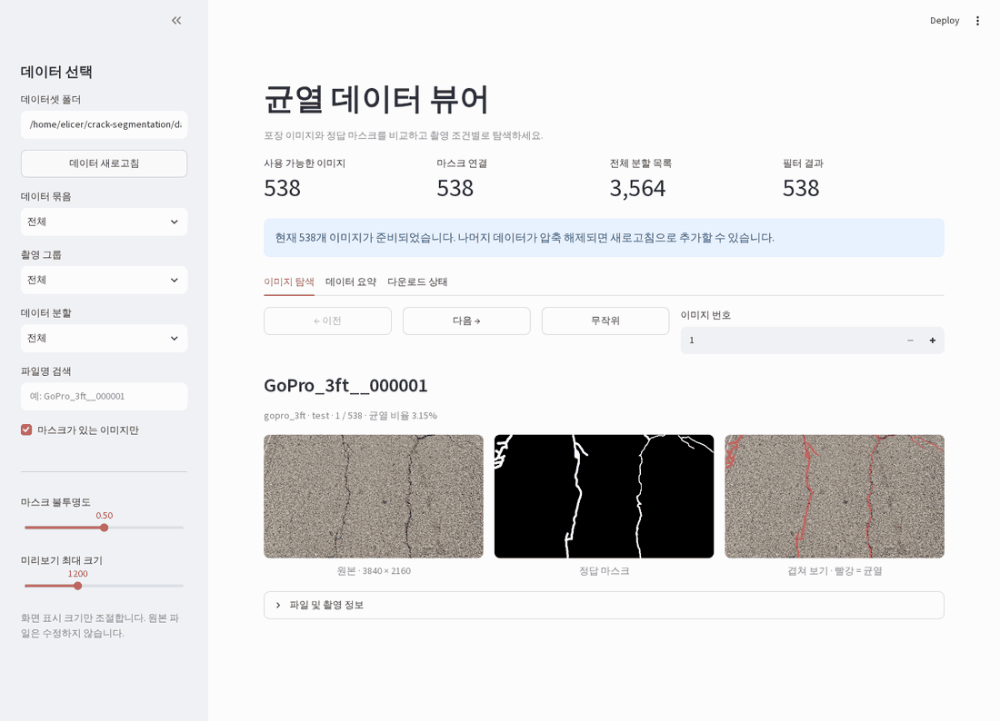

# Crack Segmentation

Resumable dataset downloads and a Streamlit image/mask viewer.

이어받기 가능한 데이터 다운로드와 이미지·마스크 Streamlit 뷰어입니다.



## Run / 실행

Requires Linux, Python 3.11, [uv](https://docs.astral.sh/uv/) and `wget`. Run from the repository root.

Linux, Python 3.11, uv, wget이 필요합니다. 저장소 루트에서 실행하세요.

```bash
uv sync --locked --extra viewer

# Download or resume; verify all files, then extract.
# 다운로드·이어받기 → 전체 파일 검증 → 압축 해제
uv run --locked --extra viewer python utils/download_data.py --connections 4

# Viewer / 뷰어
uv run --locked --extra viewer streamlit run utils/dataset_viewer.py
```

Open <http://localhost:8501>; forward port **8501** on a remote server.

브라우저에서 접속하세요. 원격 서버는 **8501** 포트를 전달하세요.

After restarting the server, rerun the download command. Keep `dataset/` to resume.
Original ZIPs and existing extracted files are preserved; local data, caches and logs are ignored by Git.

서버 재시작 후 같은 다운로드 명령을 실행하세요. 이어받으려면 `dataset/`을 유지하세요.
원본 ZIP과 기존 압축 해제 파일은 보존되며 데이터·캐시·로그는 Git에서 제외합니다.

The viewer supports image/mask overlays, group/split filters and filename search.

이미지·마스크 겹쳐 보기, 촬영 그룹·분할 필터와 파일명 검색을 지원합니다.

## Data / 데이터

[Multi-Source Pavement Crack Segmentation Dataset](https://zenodo.org/records/22697998)
by Chaudhry Abu Bakar Imran and Flavia-Ioana Patrascu (2026), [CC BY 4.0](https://creativecommons.org/licenses/by/4.0/).
3,564 image/mask pairs (~16.2 GB). The demo shows resized source images and masks with overlays.

Imran과 Patrascu의 연구 데이터로, 이미지·마스크 3,564쌍(약 16.2GB)입니다.
데모는 원본 이미지·마스크를 축소하고 겹쳐 표시한 화면입니다.

[Utility commands / 추가 명령](utils/README.md)
